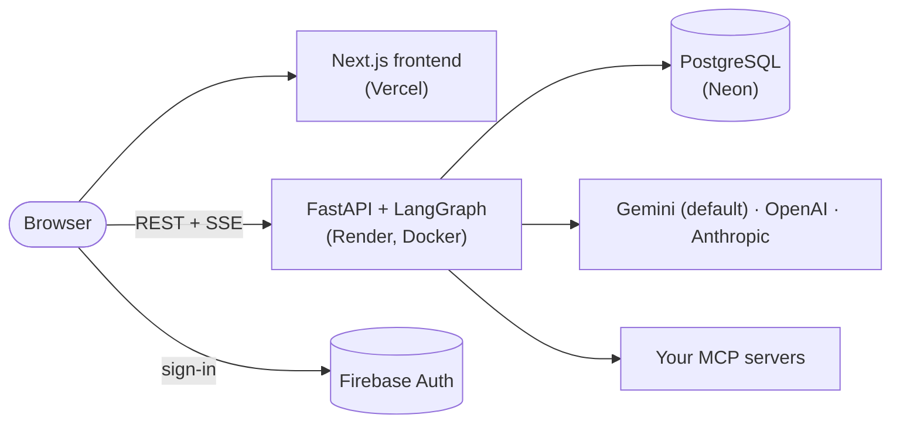

<div align="center">


# Abyss

**Build AI agents, connect real tools, and keep humans in control.**

A no-code platform for AI agents: describe what an agent does, connect its tools through MCP,
give it specialists that work in parallel, and approve anything sensitive before it runs.

[](https://github.com/pavankumarbattineni/Abyss/actions/workflows/ci.yml)


**Live:** https://abyss-fleet.vercel.app · Sibling app: [Trench](https://trenchai.vercel.app) (chat with your documents)

</div>

---

## Features

- **Agents without code**: a name, instructions and a model; edit them on a visual builder canvas.
- **Real tools via MCP**: connect any MCP server; credentials are encrypted at rest (Fernet).
- **Specialists**: a main agent delegates to up to five sub-agents that run in parallel, then writes the answer.
- **Human approval**: tools marked "requires approval" pause the run until you allow or deny them.
- **Visible reasoning**: a timeline of each turn's thinking, delegations and tool calls, streamed live.
- **Rich answers**: Markdown, maths, Mermaid diagrams, interactive charts and tables, copy buttons.
- **Models**: runs on Gemini 3.5 Flash-Lite by default (the platform's key); bring your own OpenAI, Anthropic or Gemini key for other models.
- **Usage & cost**: tokens and cost per run, filterable and downloadable as CSV.
- **API access**: personal API keys for calling agents from your own code.

## Architecture



| Folder | What it is |
|---|---|
| [`abyss_backend/`](abyss_backend/) | FastAPI API and the LangGraph agents (Python 3.13, SQLAlchemy, Alembic) |
| [`abyss_frontend/`](abyss_frontend/) | Next.js 16 web app (React 19, TypeScript, Tailwind 4, TanStack Query) |

Firebase verifies who you are; the backend then issues its own short-lived JWTs for every API
call. Each chat turn runs as a background task; the browser follows it over Server-Sent Events and
can reconnect mid-answer. LangGraph checkpoints live in the same Postgres database.

## Run locally

**Prerequisites:** Python 3.13 with [uv](https://docs.astral.sh/uv/), Node.js 24, PostgreSQL, and a
Firebase project with Email/Password and Google sign-in enabled.

```bash
# Backend -> http://127.0.0.1:8100 (migrates the database and seeds the model catalog on start)
cd abyss_backend
cp .env.example .env          # fill in ABYSS_CONFIG, ABYSS_FIREBASE_ADMIN_CONFIG
uv sync
uv run python scripts/dev.py --reload

# Frontend -> http://localhost:3100
cd abyss_frontend
cp .env.example .env.local    # NEXT_PUBLIC_API_URL=http://localhost:8100 + Firebase web config
npm ci
npm run dev -- -p 3100
```

**Or everything in Docker** (Postgres on 5434, backend 8100, frontend 3100):

```bash
# abyss_backend/.env.compose: POSTGRES_USER/PASSWORD/DB + ABYSS_CONFIG with DB host "postgres"
docker compose --env-file abyss_frontend/.env.local up --build
```

## Configuration

| Variable | Where | What |
|---|---|---|
| `ABYSS_CONFIG` | backend | JSON: `DB` (add `"ssl": true` for Neon), `LLM` (platform default provider + model and the platform's API keys, e.g. Gemini), `JWT`, `MCP.encryption_key`, `LANGSMITH`. See [`.env.example`](abyss_backend/.env.example) |
| `ABYSS_FIREBASE_ADMIN_CONFIG` | backend | Firebase service-account JSON |
| `ABYSS_ALLOWED_ORIGINS` | backend | Frontend URL(s), comma-separated (CORS; `*` is refused) |
| `NEXT_PUBLIC_API_URL` | frontend | Backend URL, no trailing slash |
| `NEXT_PUBLIC_FIREBASE_*` | frontend | Firebase web config (public by design) |

## Deployment

| Piece | Service | Notes |
|---|---|---|
| Database | Neon | `production` and `staging` branches; direct (non-pooler) host |
| Backend | Render (Docker, free) | Root `abyss_backend`, health check `/health`, auto-deploy off |
| Frontend | Vercel | Root `abyss_frontend`, production branch `development` |

**CI** ([`ci.yml`](.github/workflows/ci.yml)), on every push and pull request: ruff, migrations
from an empty database (run twice), `alembic check`, pytest on a real Postgres; eslint, type check
and build; both Docker images built and scanned with Trivy.

**CD** ([`deploy.yml`](.github/workflows/deploy.yml)), after CI passes on `development`: migrate
Neon staging → wait for approval → migrate Neon production → deploy that exact commit to Render →
wait until `/health` reports it → deploy Vercel. Run it manually with a commit SHA to roll back.
It needs GitHub environments `staging` (`ABYSS_CONFIG`) and `production` (`ABYSS_CONFIG`,
`RENDER_DEPLOY_HOOK_URL`, `VERCEL_DEPLOY_HOOK_URL`, required reviewer), plus repository
variables `BACKEND_URL` and `FRONTEND_URL`.

## Development

```bash
cd abyss_backend && uv run ruff check . && uv run pytest -q   # backend lint + tests
cd abyss_frontend && npm run lint && npm run build            # frontend lint + build
uv run alembic revision --autogenerate -m "..."               # after changing database/models.py
```

Branches: `main` and `development` are permanent; work happens on `Abyss-<N>-<Title>` branches
from `development`, merged by pull request once CI passes.
